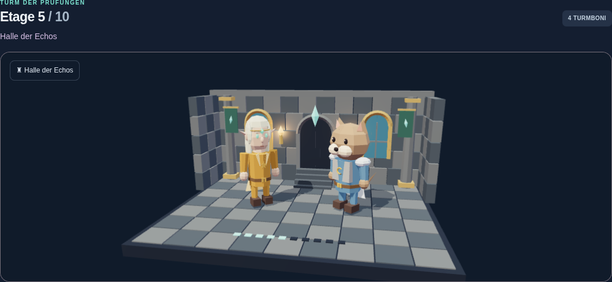
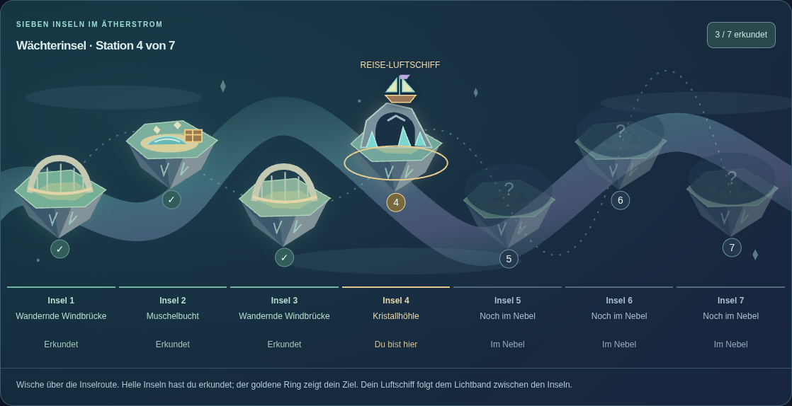
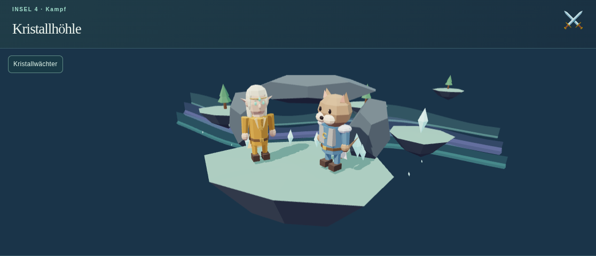
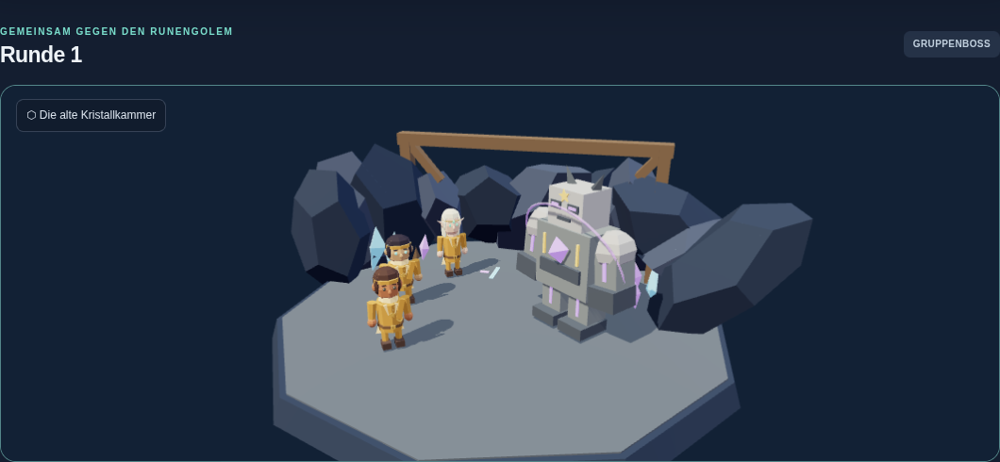

# Abenteuer in Aetheria

Version 0.12 gibt den drei Abenteuern eigene Schauplätze. Die Landschaften folgen dem gespeicherten Fortschritt, auch bei bereits begonnenen Reisen. Entscheidungen, Gegnerwerte und Belohnungen funktionieren wie zuvor.

## Turm der Prüfungen

Du kämpfst in steinernen Turmkammern mit Fliesen, Säulen, Fackeln, Runenfenstern und einer Treppe. Die Namen und Lichtstimmungen der Räume verändern sich beim Aufstieg. Ein Turmmodell mit leuchtenden Fenstern und zehn Etagenmarkierungen zeigt deinen tatsächlichen Fortschritt.

## Die wandelnde Insel

Eine Kette aus sieben kleinen Inseln schwebt im Ätherstrom. Die Übersicht zeigt besuchte Inseln, dein nächstes Ziel und das Reise-Luftschiff. Auf schmalen Bildschirmen lässt sich die Inselroute durch Wischen erkunden; sie zentriert den aktuellen Reiseabschnitt. Unbekannte Inseln bleiben im Nebel.

Bei einer Landung wechselt die Landschaft zur gewählten Begegnung: Kristallhöhle, Dornenpfad, Quellenlager, Ruinen oder Leuchtturm haben passende Motive. Im Hintergrund schweben weitere Inselstücke in einem Lichtband aus Türkis und Violett. Dieses Lichtband stellt den Ätherstrom in der Luft dar.

## Kristallminen und Runengolem

Eure Gruppe steht in einer Felskammer mit großen Ätherkristallen, alten Minenstützen und Runenzeichen. Die Gruppenaktionen und der gemeinsame Sonnen- und Mondrunenmechanismus bleiben erhalten.

## Darstellung und Update

Die Schauplätze entstehen lokal aus 3D-Geometrie. Auch ohne verfügbare 3D-Grafik zeigt jedes Abenteuer eine passende gezeichnete Landschaft. Wolken, Luftschiff und Fackeln berücksichtigen die Systemeinstellung für reduzierte Bewegung.

Für das Update sind keine neuen Installationen nötig. Den bisherigen `.data`-Ordner übernehmen und den Server neu starten; anschließend die Seite neu laden. Die genaue [Windows-Updateanleitung steht in der README](../README.md#update-unter-windows).
