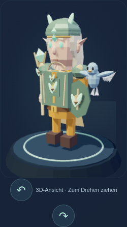
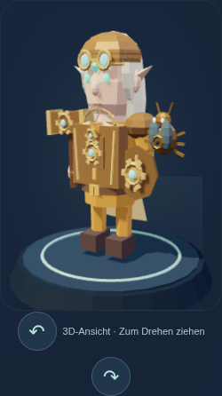
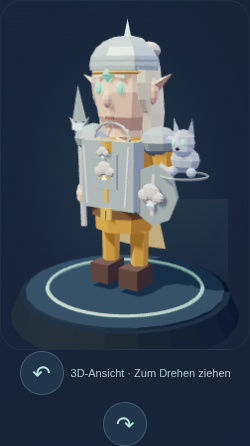
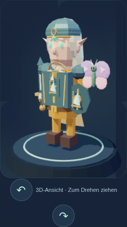
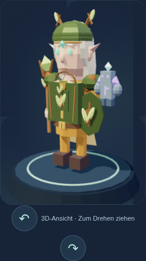
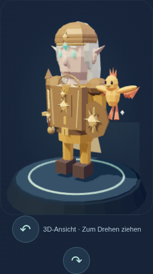

# Ausrüstung und Begleiter aus Aetheria

Die Beispiele zeigen sechs vollständige Kollektionen in der Seltenheit **Selten**. Ausrüstung und Begleiter sind frei kombinierbar; alle Völker können alle Gegenstände tragen. Begleiter sind rein optisch. Die Bilder stammen aus der 3D-Darstellung des Spiels.

| Kollektion und Herkunft | Beispiel mit Begleiter |
| --- | --- |
| **Silberlaub · Silberwind** – Lichtblattstab und Blätterschmuck. Begleiter: Ätherfalke. |  |
| **Zahnrad · Zephyria** – Ätherwerkhammer, Messing und Mechanik. Begleiter: Zahnradkäfer. |  |
| **Nebelwacht · Nebelheim** – Gipfellicht-Speer und helle Wolkenmotive. Begleiter: Äthertauflinker. |  |
| **Windfahrt · Himmelsruhe** – Reiseklinge und Kompassmotive. Begleiter: Ätherblütenfalter. |  |
| **Wurzelbund · Ätherhain** – Naturstab, Ranken und Blätter. Begleiter: Kristallgolem. |  |
| **Sonnenglas · Äthkern** – Sonnenklinge und Wüstenmotive. Begleiter: Junger Ätherphönix. |  |

Ausrüstung stammt aus Lehrertruhen. Die Freischaltungen der Begleiter stehen in der Sammlung und in der [Spielbeschreibung](../README.md#begleiter-outfits-und-trophäen).
