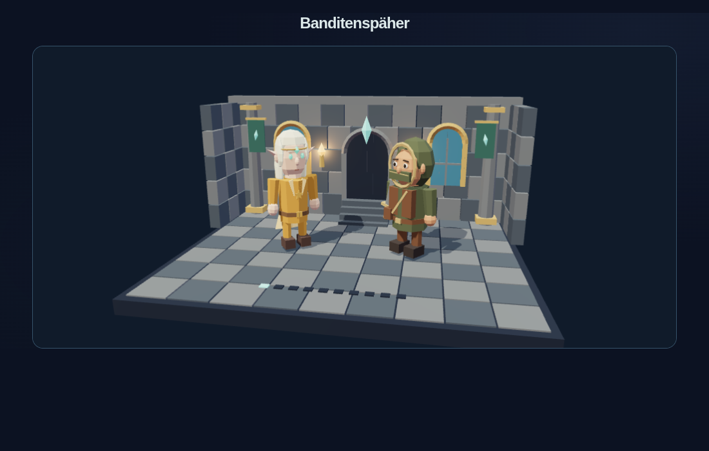
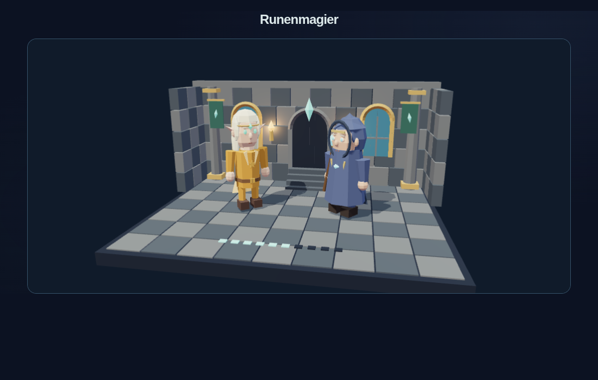
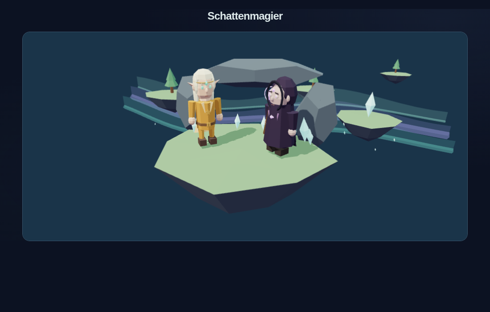
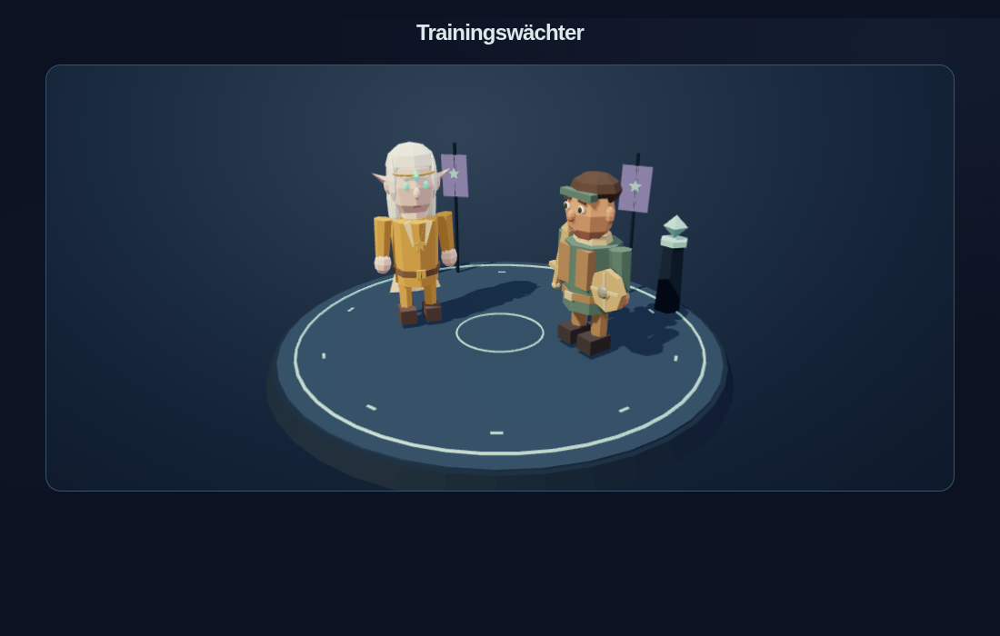
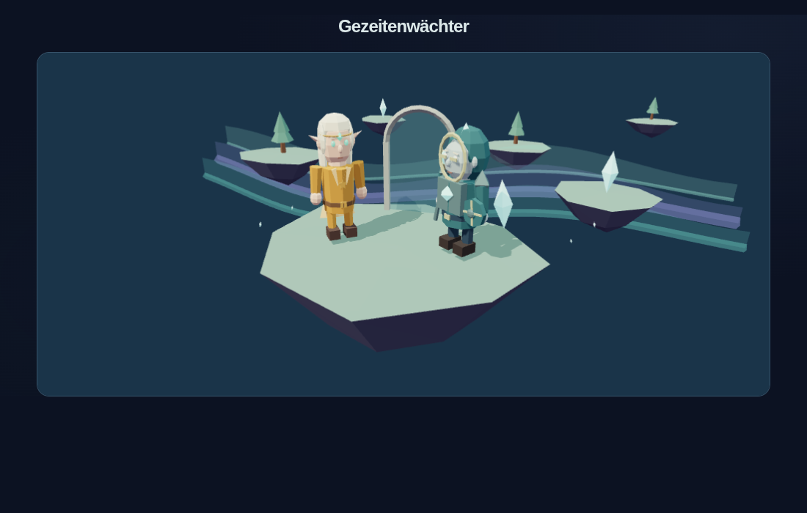

# Gegner in Aetheria

Version 0.14 gibt Training, Turm und Inselreise eigene menschliche Gegner. Banditen tragen Leder, Kapuzen oder Masken; Magier zeigen Roben, Stäbe und Runen. Die 3D-Modelle und die gezeichneten Porträts stellen dieselben Gegnertypen dar.

| Ort | Gegner |
| --- | --- |
| Übungsmodus | Menschlicher Übungsmeister mit Übungswaffe |
| Turmetage 1–5 | Banditenspäher, Banditenschläger und Banditenhauptleute |
| Turmetage 6–10 | Runenmagier, Sturmmagier und der Magier der Turmkuppel |
| Dornenpfad auf der Insel | Banditen |
| Kristallhöhle auf der Insel | Dunkle Kristall- und Schattenmagier |
| Inselfinale | Humanoider Gezeitenwächter mit Kristallrüstung |

Der Runengolem bleibt ein Golem. Die spielbaren Völker und die tierischen Begleiter behalten ihre eigene Darstellung.

## Vorschau

### Banditen auf den unteren Turmetagen

### Magier auf den oberen Turmetagen

### Dunkle Magier auf den Inseln

### Menschlicher Übungsmeister

### Gezeitenwächter im Inselfinale

## Etwas mehr Herausforderung

Für neue Abenteuer werden die bisherigen Grundwerte moderat angehoben:

| Gegner | Lebenspunkte | Angriffsschaden |
| --- | --- | --- |
| Turm- und Inselgegner einschließlich Gezeitenwächter | bisheriger Wert × 1,12 | bisheriger Wert × 1,10 |
| Runengolem | bisheriger Wert × 1,10 | bisheriger Wert × 1,08 |

Die Ergebnisse werden auf ganze Punkte gerundet. Der neue Übungsmeister besitzt **103 LP**, verursacht **15 normalen Schaden** und **23 Fokus-Schaden**; zuvor waren es 92 LP, 14 und 21 Schaden.

Angekündigte Angriffe, Ätherenergie, drei wählbare Fähigkeiten, Zustände und Bossphasen bleiben bestehen. Deckung, Schutz und eine passende Kombination von Fähigkeiten helfen beim Fortschritt. Die Änderung vergibt keine zusätzlichen XP oder Gegenstände und verändert keine Spielerwerte oder Schülerduelle.

## Bereits begonnene Kämpfe

Vorhandene Gegner erhalten ihre neue Darstellung, ohne ihre gespeicherten Lebenspunkte, Angriffe oder Zugfolgen umzuschreiben. Auch spätere Etagen und Stationen eines bereits begonnenen Abenteuerlaufs behalten dessen bisherige Schwierigkeitsstufe. Für die erhöhte Schwierigkeit einen **neuen Kampf beziehungsweise Abenteuerlauf** beginnen.

Beim Update den bisherigen `.data`-Ordner übernehmen. Die [Windows-Updateanleitung steht in der README](../README.md#update-unter-windows).

Die Version wurde mit **196 automatischen Tests** geprüft. Zusätzliche Browserprüfungen kontrollieren die neuen Porträts, alle fünf 3D-Gegnertypen mit Kampfanimationen sowie die Abenteueransicht in iPad- und Handygröße.
