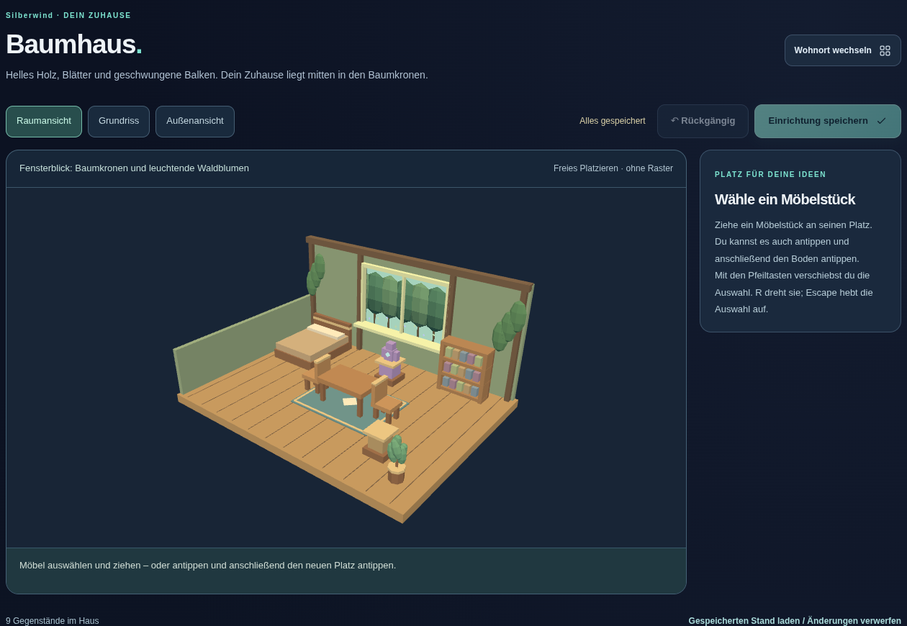
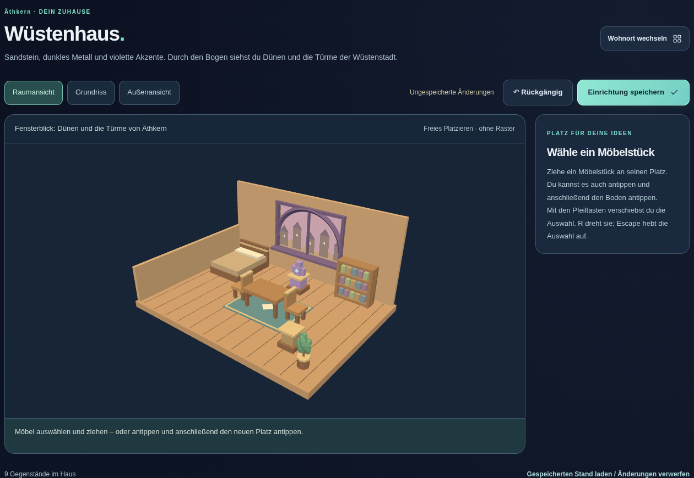
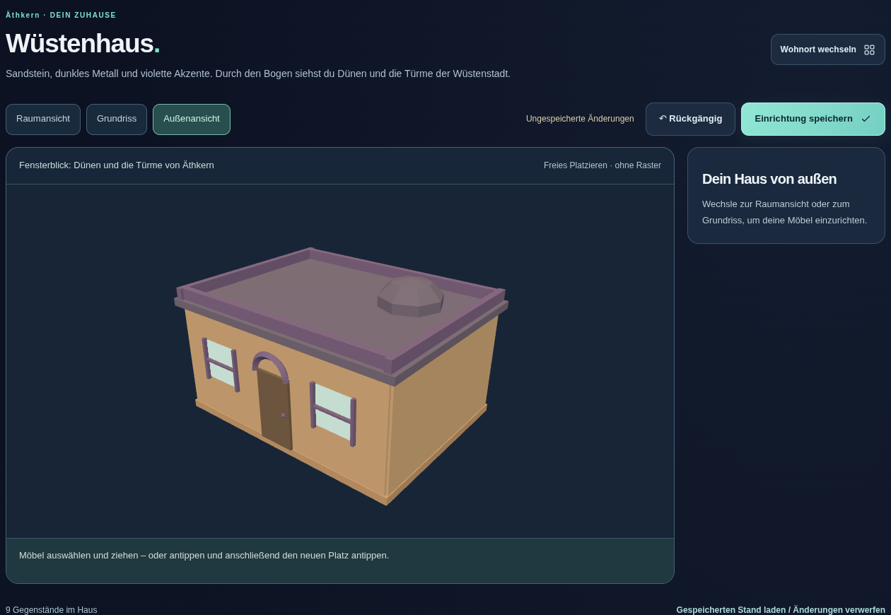

# Dein Zuhause in Aetheria

Ab Version 0.15 können Schülerkonten unter **Mein Haus** einen eigenen Wohnort wählen und ihr Haus einrichten. Der erste Einzug und spätere Umzüge sind kostenlos. Die Einrichtung bleibt beim Umzug erhalten.

## Wohnorte

| Wohnort | Haus | Blick aus dem Fenster |
| --- | --- | --- |
| Zephyria | Zahnradhaus aus Stein, Holz und Messing | Berggipfel und Ingenieursdächer |
| Silberwind | Baumhaus mit Blättern und Holzbalken | Baumkronen und Waldblumen |
| Nebelheim | Wolkenhaus mit hellem Stein und Säulen | Wolken und hohe Bergspitzen |
| Himmelsruhe | Hafenhaus mit Holzdeck und Flagge | Luftschiffe im Ätherstrom |
| Lysara | Gemütliches Fachwerkhaus | Marktplatz und grüne Hügel |
| Ätherhain | Hainhütte mit Moos und Wurzeln | Nebelwald und Ätherpflanzen |
| Äthkern | Wüstenhaus mit flachem Dach und violetten Akzenten | Dünen und Stadttürme |

## Vorschau

### Ein Baumhaus einrichten

### Das Baumhaus von außen

### Wohnen in der Wüste

Die Vorschau zeigt ein Demokonto mit bereits verdienten Trophäen. Neue Konten beginnen mit der Grundausstattung.

## Möbel frei platzieren

1. **Mein Haus** öffnen, einen Wohnort wählen und mit **Einziehen & speichern** einziehen.
2. Ein vorhandenes Möbelstück mit der Maus ziehen. Auf dem iPad kann man es auch **antippen und anschließend den neuen Platz auf dem Boden antippen**.
3. Nach der Auswahl mit den Drehknöpfen oder dem Winkelregler drehen. Die Pfeilknöpfe und **Feinposition** helfen bei kleinen Verschiebungen.
4. Im **Lager** weitere Möbel über **Aufstellen** hinzufügen. **Zurück ins Lager** räumt ein Stück weg; es bleibt im Besitz.
5. Mit **Einrichtung speichern** den fertigen Stand sichern.

Die Platzierung auf dem Boden hat kein festes Raster. Möbel dürfen auf Teppichen stehen; Überschneidungen mit anderen Möbeln und Positionen durch Wände werden abgefangen. Trophäen bringen ihren eigenen Sockel mit und können ebenfalls frei auf dem Boden platziert werden.

**Rückgängig** nimmt die letzten Änderungen zurück. **Gespeicherten Stand laden / Änderungen verwerfen** stellt den zuletzt gespeicherten Stand wieder her. Ein kurzer Wechsel in einen anderen Spielbereich behält den Entwurf; zum dauerhaften Aufbewahren vor dem Abmelden speichern.

Die **Raumansicht** zeigt das offene 3D-Zimmer, **Grundriss** bietet den Blick von oben, **Außenansicht** zeigt die Architektur. Ohne geeignete Grafikunterstützung erscheint ein gezeichneter Grundriss, in dem sich die Möbel weiterhin bewegen und drehen lassen.

Mit Tastatur: Die Hausansicht fokussieren, ein Möbelstück auswählen und mit den Pfeiltasten bewegen. **Umschalt + Pfeiltaste** bewegt es weiter, **R** dreht um 15 Grad, **Escape** hebt die Auswahl auf.

## Möbel sammeln und Trophäen ausstellen

Die Grundausstattung umfasst **neun Stücke**: ein Bett, einen Tisch, zwei Stühle, einen Teppich, ein Bücherregal, einen Farn und zwei Ausstellungssockel. Acht stehen beim ersten Einzug schon im Zimmer; der zweite Sockel liegt im Lager.

Weitere Möbel werden durch **gesicherte Abenteuererfolge** freigeschaltet. Bereits verdiente Erfolge zählen automatisch mit. Im Lager zeigt **Alle Entwürfe** auch die noch gesperrten Stücke und ihren Fundort.

| Erfolg | Neue Möbel |
| --- | --- |
| Turmetage 2 abschließen und Funde sichern | Glühwürmchenlaterne, Silberlaub-Bäumchen |
| Turmetage 4 abschließen und Funde sichern | Sternenpolster-Sofa, Sternenteppich |
| Turmetage 6 abschließen und Funde sichern | Zahnrad-Kommode, Ingenieurslampe, Turmtrophäe auf Sockel |
| Turmetage 8 abschließen und Funde sichern | Wolkensessel, Wolkenregal |
| Alle zehn Turmetagen bezwingen | Sternenfernrohr, Sonnenseidenbett, Turmmeister auf Sockel |
| Drei Inselstationen abschließen und Funde sichern | Muscheltruhe, Ätherblüten |
| Fünf Inselstationen abschließen und Funde sichern | Wurzeltisch, Moospolster |
| Alle sieben Inselstationen bezwingen | Kartenkommode, Ätherstrom-Teppich, Kompass der Insel auf Sockel |
| Runengolem gemeinsam bezwingen | Runenkristall-Lampe, kleiner Runenwächter, Runengolembezwinger auf Sockel |

Insgesamt gibt es **29 Entwürfe einschließlich vier Trophäen auf Sockeln**. Das Aufstellen erhält den Eintrag in der Sammlung. Alle Hausgegenstände sind kosmetisch.

## Speicherung und Prüfung

Wohnort, Positionen und Drehwinkel werden für jedes Schülerkonto in der vorhandenen SQLite-Datenbank gespeichert. Gleichzeitige Änderungen aus zwei Browsern überschreiben einander nicht unbemerkt: Bei einem Konflikt bleibt der Entwurf erhalten und der gespeicherte Stand kann neu geladen werden.

Beim Update den bisherigen `.data`-Ordner übernehmen; die neue Tabelle wird automatisch angelegt. Die [Windows-Updateanleitung steht in der README](../README.md#update-unter-windows).

Alle **207 automatischen Tests** bestehen. Zusätzliche Browserprüfungen decken freies Verschieben und Drehen mit Maus und Touch, Speichern und Neuladen, Umzüge, Trophäen, konkurrierende Speicherungen, alle sieben 3D-Hausstile und den Wechsel zum bedienbaren Grundriss nach Verlust der Grafikunterstützung ab. Die Oberfläche wurde in Desktop-, iPad- und Handygröße geprüft.
