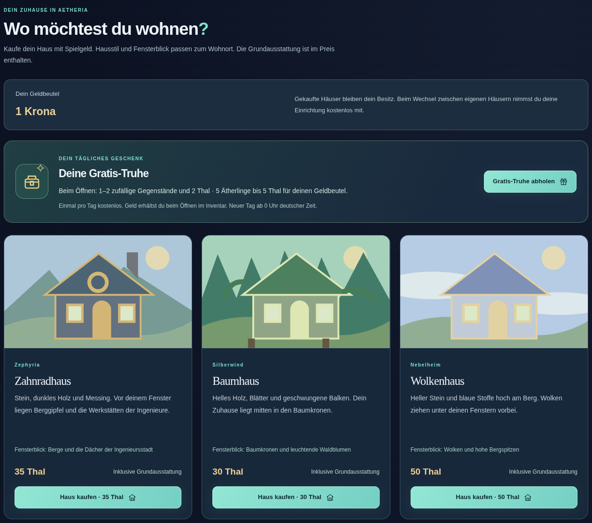
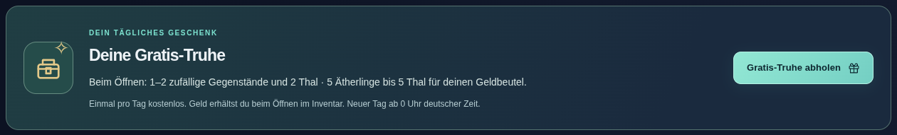
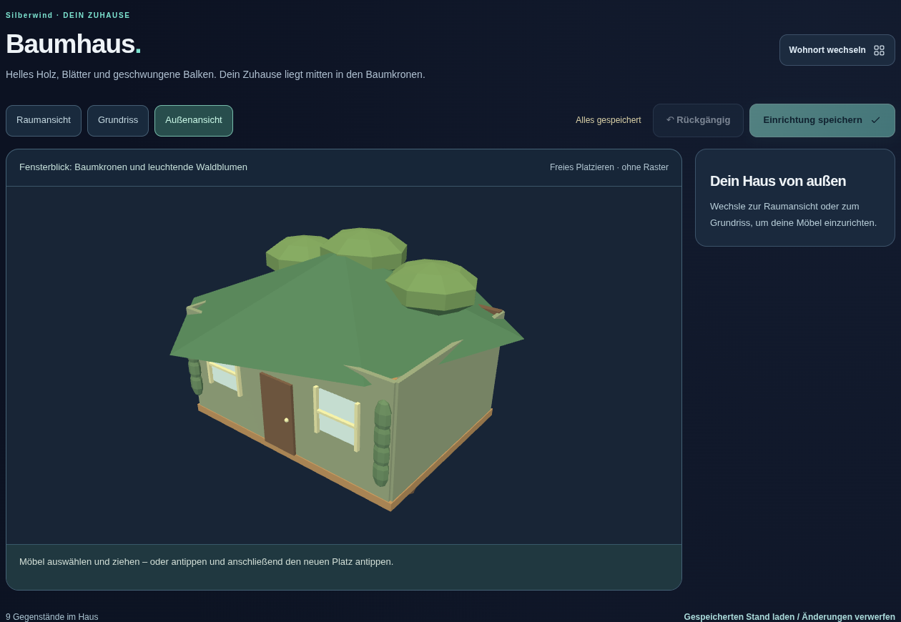

# Dein Zuhause in Aetheria

Ab Version **0.16** kaufen Schülerkonten unter **Mein Haus** ihr Zuhause mit Spielgeld. Häuser und Luftschiffe nutzen denselben Geldbeutel. Gekaufte Häuser bleiben im Besitz; zwischen eigenen Häusern kann man kostenlos wechseln und die Einrichtung mitnehmen.

## Wohnorte

| Wohnort | Haus | Preis | Blick aus dem Fenster |
| --- | --- | --- | --- |
| Ätherhain | Hainhütte mit Moos und Wurzeln | 15 Thal | Nebelwald und Ätherpflanzen |
| Lysara | Gemütliches Fachwerkhaus | 20 Thal | Marktplatz und grüne Hügel |
| Silberwind | Baumhaus mit Blättern und Holzbalken | 30 Thal | Baumkronen und Waldblumen |
| Zephyria | Zahnradhaus aus Stein, Holz und Messing | 35 Thal | Berggipfel und Ingenieursdächer |
| Äthkern | Wüstenhaus mit flachem Dach und violetten Akzenten | 40 Thal | Dünen und Stadttürme |
| Nebelheim | Wolkenhaus mit hellem Stein und Säulen | 50 Thal | Wolken und hohe Bergspitzen |
| Himmelsruhe | Hafenhaus mit Holzdeck und Flagge | 60 Thal | Luftschiffe im Ätherstrom |

**10 Ätherlinge = 1 Thal; 100 Thal = 1 Krona.** Die Preise sind eine erste Spielbalance. Alle Häuser haben denselben nutzbaren Raum; die Grundausstattung ist im Kaufpreis enthalten. Das erste gekaufte Haus wird sofort bezogen. Weitere Käufe ergänzen den Besitz, ohne einen laufenden Einrichtungsentwurf zu überschreiben. Zum Wechsel ein eigenes Haus wählen und **Umzug & Einrichtung speichern** drücken.

## Einmal täglich eine Gratis-Truhe

Auf der **Übersicht**, im **Inventar** und bei der **Hausauswahl** gibt es die Schaltfläche **Gratis-Truhe abholen**. Jedes Schülerkonto kann **eine Truhe je Kalendertag** abholen. Der neue Tag beginnt um **0 Uhr deutscher Zeit (Europe/Berlin)**; Sommer- und Winterzeit werden berücksichtigt. Verpasste Tage werden nicht nachgeholt.

Die Truhe landet ungeöffnet im Inventar. **Eine Truhe öffnen** liefert die normalen **1–2 zufälligen Gegenstände und zusätzlich Geld nach dem aktuellen Spielerlevel**. Auf Level 1 sind es 15–30 Ätherlinge; damit kostet die günstigste Hainhütte fünf bis zehn tägliche Truhen. Mit steigendem Level erhöht sich der Geldbetrag wie bei Lehrertruhen. Die Truhe lässt sich unabhängig von Lehrerbelohnungen abholen und später öffnen.

Das tägliche Abholen selbst vergibt keine XP. Lehrkräfte können weiterhin zusätzliche Schulbelohnungen vergeben. Neue Möbel, Deko und Trophäen erhält man über gesicherte Abenteuererfolge.

## Vorschau

### Ein Baumhaus einrichten

### Das Baumhaus von außen

### Wohnen in der Wüste

Die Vorschau zeigt ein Demokonto mit bereits verdienten Trophäen. Neue Konten beginnen mit der Grundausstattung.

## Möbel frei platzieren

1. **Mein Haus** öffnen und beim gewünschten Wohnort **Haus kaufen** wählen. Der Preis wird einmalig aus dem Geldbeutel bezahlt; das erste Haus ist direkt bezugsfertig.
2. Ein vorhandenes Möbelstück mit der Maus ziehen. Auf dem iPad kann man es auch **antippen und anschließend den neuen Platz auf dem Boden antippen**.
3. Nach der Auswahl mit den Drehknöpfen oder dem Winkelregler drehen. Die Pfeilknöpfe und **Feinposition** helfen bei kleinen Verschiebungen.
4. Im **Lager** weitere Möbel über **Aufstellen** hinzufügen. **Zurück ins Lager** räumt ein Stück weg; es bleibt im Besitz.
5. Mit **Einrichtung speichern** den fertigen Stand sichern.

Die Platzierung auf dem Boden hat kein festes Raster. Möbel dürfen auf Teppichen stehen; Überschneidungen mit anderen Möbeln und Positionen durch Wände werden abgefangen. Trophäen bringen ihren eigenen Sockel mit und können ebenfalls frei auf dem Boden platziert werden.

**Rückgängig** nimmt die letzten Änderungen zurück. **Gespeicherten Stand laden / Änderungen verwerfen** stellt den zuletzt gespeicherten Stand wieder her. Ein kurzer Wechsel in einen anderen Spielbereich behält den Entwurf; zum dauerhaften Aufbewahren vor dem Abmelden speichern.

Die **Raumansicht** zeigt das offene 3D-Zimmer, **Grundriss** bietet den Blick von oben, **Außenansicht** zeigt die Architektur. Ohne geeignete Grafikunterstützung erscheint ein gezeichneter Grundriss, in dem sich die Möbel weiterhin bewegen und drehen lassen.

Mit Tastatur: Die Hausansicht fokussieren, ein Möbelstück auswählen und mit den Pfeiltasten bewegen. **Umschalt + Pfeiltaste** bewegt es weiter, **R** dreht um 15 Grad, **Escape** hebt die Auswahl auf.

## Möbel sammeln und Trophäen ausstellen

Die im Kaufpreis enthaltene Grundausstattung umfasst **neun Stücke**: ein Bett, einen Tisch, zwei Stühle, einen Teppich, ein Bücherregal, einen Farn und zwei Ausstellungssockel. Acht stehen beim ersten Einzug schon im Zimmer; der zweite Sockel liegt im Lager. Beim Kauf weiterer Häuser wird die bestehende gemeinsame Einrichtung übernommen.

Weitere Möbel werden durch **gesicherte Abenteuererfolge** freigeschaltet. Bereits verdiente Erfolge zählen automatisch mit. Im Lager zeigt **Alle Entwürfe** auch die noch gesperrten Stücke und ihren Fundort.

| Erfolg | Neue Möbel |
| --- | --- |
| Turmetage 2 abschließen und Funde sichern | Glühwürmchenlaterne, Silberlaub-Bäumchen |
| Turmetage 4 abschließen und Funde sichern | Sternenpolster-Sofa, Sternenteppich |
| Turmetage 6 abschließen und Funde sichern | Zahnrad-Kommode, Ingenieurslampe, Turmtrophäe auf Sockel |
| Turmetage 8 abschließen und Funde sichern | Wolkensessel, Wolkenregal |
| Alle zehn Turmetagen bezwingen | Sternenfernrohr, Sonnenseidenbett, Turmmeister auf Sockel |
| Drei Inselstationen abschließen und Funde sichern | Muscheltruhe, Ätherblüten |
| Fünf Inselstationen abschließen und Funde sichern | Wurzeltisch, Moospolster |
| Alle sieben Inselstationen bezwingen | Kartenkommode, Ätherstrom-Teppich, Kompass der Insel auf Sockel |
| Runengolem gemeinsam bezwingen | Runenkristall-Lampe, kleiner Runenwächter, Runengolembezwinger auf Sockel |

Insgesamt gibt es **29 Entwürfe einschließlich vier Trophäen auf Sockeln**. Das Aufstellen erhält den Eintrag in der Sammlung. Alle Hausgegenstände sind kosmetisch.

## Speicherung und Prüfung

Gekaufte Häuser, Wohnort, Positionen und Drehwinkel werden für jedes Schülerkonto in der vorhandenen SQLite-Datenbank gespeichert. Gleichzeitige Änderungen aus zwei Browsern überschreiben einander nicht unbemerkt: Bei einem Konflikt bleibt der Entwurf erhalten und der gespeicherte Stand kann neu geladen werden. Käufe und tägliche Truhen werden auf dem Server geprüft; wiederholte oder gleichzeitige Anfragen können weder doppelt abbuchen noch mehrere Tagestruhen vergeben.

Beim Update den bisherigen `.data`-Ordner übernehmen; neue Tabellen werden automatisch angelegt. Ein vor diesem Update bereits gespeichertes Haus wird mit seiner Einrichtung in den Besitz übernommen, ohne nachträgliche Abbuchung. Geldbeutel und Spielstände bleiben erhalten. Die [Windows-Updateanleitung steht in der README](../README.md#update-unter-windows).

Alle **219 automatischen Tests** bestehen. Die Wirtschaftsprüfungen decken Hauspreise, Besitzrechte, konkurrierende Käufe aus demselben Geldbeutel, tägliche Truhen, Tageswechsel, Sommer-/Winterzeit und die Übernahme bestehender Spielstände ab. Ein vollständiger Test spart mit einem neuen Konto ausschließlich über tägliche Truhen auf das erste Haus.

Zusätzliche Browserprüfungen decken den Ablauf Gratis-Truhe → Öffnen → Hauskauf, freie Einrichtung mit Maus und Touch, Speichern und Neuladen, kostenlose Umzüge zwischen eigenen Häusern, Trophäen, konkurrierende Speicherungen, alle sieben 3D-Hausstile und den bedienbaren Grundriss ohne Grafikunterstützung ab. Die Oberfläche wurde in Desktop-, iPad- und Handygröße geprüft.
