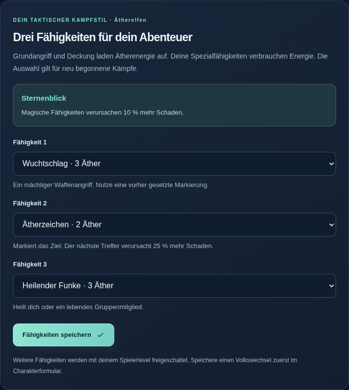

# Taktische Kämpfe in Aetheria

Version 0.13 setzt die ersten fünf Erweiterungen des Kampfsystems um. Das Spiel bleibt rundenbasiert. Duelle vergeben weiterhin keine zusätzlichen schulischen XP.

## Ätherenergie und drei Fähigkeiten

Unter **Mein Held** stellst du drei unterschiedliche Fähigkeiten zusammen und speicherst sie. Grundangriff, Deckung und die bisherigen Heiltränke im Duell bleiben zusätzlich verfügbar. Angriff und Deckung geben jeweils **2 Ätherenergie**, bis zum Maximum von **6**. Zu Kampfbeginn stehen normalerweise **2** Energie bereit; Luftnomaden starten mit **3**.

Spezialfähigkeiten kosten **2–4** Energie. Ihre Karten zeigen Kosten, Wirkung und Ziel. Bei zu wenig Energie sind sie gesperrt. Es gibt insgesamt **18 Fähigkeiten**: sechs gemeinsame und je zwei besondere Fähigkeiten für jedes Volk. Der gemeinsame Schildstoß wird auf Spielerlevel 3 freigeschaltet, die zweite besondere Volksfähigkeit auf Level 5. Fähigkeiten werden frei aus den verfügbaren Möglichkeiten gewählt und kosten beim Auswählen keine XP.

## Stärken der Völker

| Volk | Besondere Stärke |
| --- | --- |
| Ätherelfen | Magische Fähigkeiten verursachen 10 % mehr Schaden. |
| Ätheringenieure | Physische Fähigkeiten verursachen 10 % mehr Schaden. |
| Wolkenhüter | Ihre Schutzfähigkeiten fangen 10 Prozentpunkte mehr Schaden ab. |
| Luftnomaden | Beginnen mit einer zusätzlichen Ätherenergie. |
| Ätherdruiden | Heilfähigkeiten heilen 20 % mehr Lebenspunkte. |
| Ätherdämmerer | Unter halben Lebenspunkten verursachen physische Fähigkeiten 20 % mehr Schaden. |

Die bisherigen unterschiedlichen Startwerte von Stärke, Fokus und Ausdauer bleiben bestehen. Gemeinsame Fähigkeiten erlauben unterschiedliche Spielweisen innerhalb eines Volkes.

## Zustände und Kombinationen

**Markiert** verstärkt den nächsten Treffer um 25 %. **Geschwächt** vermindert den nächsten Angriff um 25 %. **Geschützt** fängt einen Teil des nächsten Treffers ab; die Stärke hängt von der eingesetzten Fähigkeit ab. Jeder Zustand wird beim passenden Treffer verbraucht oder verfällt spätestens nach zwei eigenen Aktionen. Zustände werden angezeigt und nicht beliebig gestapelt.

Ein Schildstoß kann Deckung und Schutz durchbrechen und das Ziel markieren. Ein anschließender Wuchtschlag nutzt diese Markierung. Im Gruppenkampf wirken Unterstützung und Markierungen vor den schweren Angriffen, sodass auch die Reihenfolge der Gruppenanmeldung diese Kombination ermöglicht.

## Gemeinsame Bosskämpfe

Beim Runengolem durchlauft ihr drei Phasen:

1. **Runenpanzer:** Oberhalb von 65 % seiner Lebenspunkte öffnen Sonnen- und Mondrune von zwei verschiedenen Spielern das Angriffsfenster.
2. **Steinsturm:** Bis 30 % Lebenspunkte bleibt der Panzer offen. Der Golem kündigt einen stärkeren Gruppenangriff an; Heilung, Schutz und Deckung helfen.
3. **Offener Kristallkern:** Bei höchstens 30 % Lebenspunkten erleidet er 25 % mehr Schaden und kündigt besonders schwere Gegenangriffe an.

Die Phasen wechseln zwischen den Runden. Heilung und Schutz lassen sich über die Zielwahl auf ein lebendes Gruppenmitglied richten. Fähigkeiten werden bei der Auswahl geprüft, beim gemeinsamen Auflösen der Runde genau einmal bezahlt. Auch der Gezeitenwächter auf der Insel erhält eine zweite, angekündigte Kampfphase.

## Vorhandene Spielstände

Neue Kämpfe speichern Volk, Level, drei Fähigkeiten und Ausrüstung beim Start. Eine spätere Änderung am Helden verändert laufende Kämpfe nicht. Energie und Zustände bleiben nach einem Neustart erhalten. Neue Turmetagen und Inselkämpfe beginnen mit frischer Kampfenergie.

Bereits vor Version 0.13 begonnene Kämpfe und Abenteuer behalten ihre bisherigen Regeln. Für das neue System einen neuen Kampf beziehungsweise Abenteuerlauf beginnen. Beim Update den bisherigen `.data`-Ordner übernehmen; die Datenbank wird automatisch erweitert.
